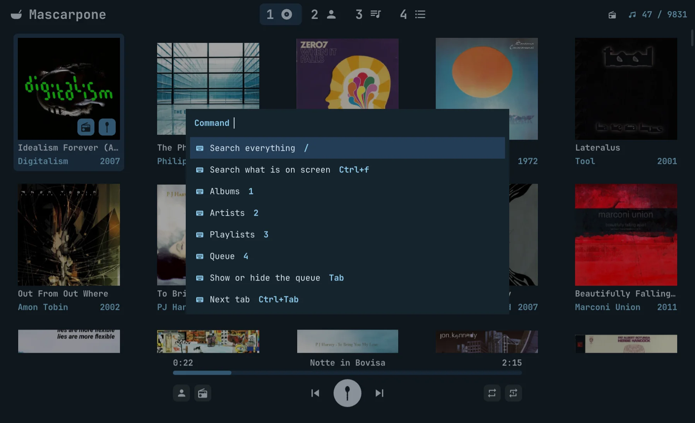

#  Mascarpone

An mpd client for the desktop (raylib, Rust): the music library, the
playlists (m3u files in a folder), the pictures, biographies and album
details fetched the way Lollypop does, the usual player commands, and
a radio: a queue that goes on by itself, each track like the ones
before it, by bliss's ear and by what the net knows of the artists.
mpd keeps the music and plays it; Mascarpone is the window on it.

Used and tested on one setup only: Arch Linux, Wayland with sway, a
local mpd (0.24) with the music in `~/Music`, PipeWire; the bar sees
what plays through mpd-mpris, not through Mascarpone. Another
distribution, X11 or another compositor may well work (GLFW opens what
it finds) but nothing has been tried there. The window's app id is
`cards.random.Mascarpone`, for a compositor's rules.

It builds and links on macOS too (Apple silicon, GLFW on Cocoa, the
system's OpenGL): mpd from Homebrew (`brew install mpd`, a `~/.mpdconf`
with an `osx` output, `brew services start mpd`), the font found by
Homebrew's `fc-match`; `music` and `playlists` in the configuration where
mpd's music is. There is no bar there to see what plays (no MPRIS), and
the window opens only from the desktop's session, the screen unlocked.

A track without an album tag is filed under its folder, which stands in
for an album, with the folder's name.

| | |
|---|---|
|  |  |
|  |  |
|  |  |

## Build

    make            # cargo build --release
    make install    # ~/.local/bin/mascarpone

raylib (6.2, without audio and models) is in `vendor/raylib` and is
built with the program, once, in `target/raylib` (`build.rs`, raylib's
own Makefile): it wants `make`, a C compiler and `wayland-scanner`.
bliss (bliss-audio 0.13, the song analysis for the radio) is in
`vendor/bliss-rs`, built with its symphonia decoder and no ffmpeg,
with one addition, `Song::analyze_series`, the analysis that keeps
also what the descriptors saw window by window, for the shape; it
is GPL-3 (its `LICENSE` is there), which a Mascarpone built with it is
distributed under. SQLite comes with rusqlite, built in. The voice
models are built in too, run by tract (ONNX, in Rust): YAMNet in
`vendor/yamnet` (Apache 2.0) and Essentia's voice/instrumental head in
`vendor/essentia-models` (CC BY-NC-SA 4.0: no commercial use).
GLFW, inside raylib, opens Wayland or X11 and EGL at run time; the font
is found by `fc-match`.
The window draws only when something changes (a key, the pointer, mpd,
a picture, the clock), and sleeps in between. On Wayland it draws a
frame only once the compositor has shown the last one: out of sight
(hidden, on another workspace) it draws nothing, the clock included.

## Configuration

`~/.config/mascarpone/mascarpone.conf`, the way `.conf` files are:
`key = value` lines under `[section]` heads, `#` starting a comment; a
key left out keeps its default, one not known is said on stderr.

    [mpd]
    host = localhost        # or a socket's path: /run/mpd/socket
    port = 6600
    password = secret

    [library]
    music = ~/Music         # mpd's music_directory
    playlists = ~/Music/Playlists

    [radio]
    threads = 4             # files analyzed at a time: a quarter of the cores

    [keys]
    play_pause = Space c    # an action = its keys, by spaces
    save_queue =            # nothing: no key

`MPD_HOST` (`password@host` too) and `MPD_PORT`, as mpc reads them, win
over the file. A key is a character as the keyboard's layout writes it
(`K` is Shift and k), or `Ctrl+`, `Alt+` and `Shift+` before a
character or a named key: Space, Enter, Escape, Tab, Backspace, Delete,
Up, Down, Left, Right, PageUp, PageDown, Home, End, KP_Add,
KP_Subtract, KP_0. Every action and its default keys:

| action | keys | |
|---|---|---|
| `commands` | Ctrl+k | the commands' picker: every action below, with its keys |
| `search_all` | / | the picker on everything |
| `search` | Ctrl+f | the picker on what is on screen |
| `albums` `artists` `playlists` `queue` | 1 2 3 4 | the tabs |
| `toggle_queue` | Tab | the queue shown, and hidden again: back where it was |
| `next_tab` `previous_tab` | Ctrl+Tab, Ctrl+Shift+Tab | |
| `back` | Escape | back a page |
| `play_pause` | Space c | |
| `stop` `previous` `next` | x z v | |
| `seek_forward` `seek_backward` | ] [ | ten seconds |
| `volume_up` `volume_down` | + =, - | five points |
| `repeat` `repeat_one` | r R | on or off |
| `go_to_playing` | g | the album or the playlist the queue plays |
| `radio` | s | the radio from what is selected: a track, an album, an artist |
| `save_queue` `clear_queue` | | |
| `refresh` | Ctrl+r | |
| `zoom_in` `zoom_out` `zoom_reset` | Ctrl+= Ctrl++, Ctrl+-, Ctrl+0 | the keypad's too |
| `quit` | Ctrl+q | |
| `left` `right` `down` `up` | j ;, k l, and the arrows | the grids and the lists |
| `open` | Enter | a card's page; on a list, play from the row |
| `add_to_playlist` | a | the selected track |
| `remove` `move_down` `move_up` | d Delete, K, L | the queue's rows |
| `picker_next` `picker_previous` | Down Tab Ctrl+n Ctrl+k, Up Shift+Tab Ctrl+p Ctrl+l | in the picker and the dialogs |
| `picker_page_down` `picker_page_up` | PageDown, PageUp | |
| `picker_open` `picker_close` | Enter, Escape Ctrl+g | |

## Use

Albums, Artists, Playlists and Queue in the header, which stays over
every page; a click on a tab, even the one on, comes back to its list
(the keys below are the defaults: 1 to 4 or Ctrl+Tab
switch, Escape goes back a page; a mouse's back button does too, and
its forward button returns to the page Back left). The tab lit is the page's kind: an
album's page lights Albums whatever tab it was opened over, and Escape
still goes back to that tab. An album's, a playlist's, an
artist's page and the queue have the same head on top, still (the
cover or the portrait, the words beside it, an artist's scrolling on
their own, the buttons at its foot on the right), and under it the tracks or the albums in a block that
scrolls, down to the player; opened, the queue shows the song on in its
middle. The album and artist grids come in a random order, dealt once
when the library first comes and kept from then on, through tabs, pages
and reloads; Ctrl+R deals them anew, and refreshes: mpd updates its
database and the library is read again. When mpd's database changes by
itself (files synced in), the library is read again once it has been
still for 30 minutes, and the grids keep their order, the albums and
artists gone dropped from it, the new ones shuffled in at the end.

One card is selected: j and ; move it left and right, k and l down and
up, Enter opens it, as does a click; the play button on an album's
cover or a playlist's covers (under the pointer, or on the selected
card) plays the album or the playlist. The
artist on an album card opens their page; an album credited to several,
"The Velvet Underground & Nico", names them one by one, each a link,
separated by commas, and sits on each one's page. On an album's or playlist's
page one track is selected (k and l, or Down and Up, move it; a click
plays from a row, or pauses the song on): Play and Enter play the list
from it, or pause and resume when it is the song on; Add to queue
appends. Space (or c) pauses and resumes anywhere, z, x and v go back,
stop and go on; Tab shows the queue and, again (or Escape), hides it:
back on the tab and the page it was asked from. A page opens once:
asked again while it is up (the player bar's album, the artist's name
on a row), it stays, the track selected; after a refresh the pages up
are opened again on the new library, in their place. Ctrl+K lists every command with its
keys: type to find one, Enter does it.

Launched with words while the window is up, Mascarpone sends them to
it over its socket and ends: `mascarpone tab queue` (or `albums`,
`artists`, `playlists`), `mascarpone artist Radiohead`, `mascarpone
album <key>` (the artist, a unit separator, the title), `mascarpone
search` (the picker on everything), `mascarpone commands` (the
commands' picker), `mascarpone escape` (a dialog closed, else back a
page). For a script, a screenshot.

The player bar at the bottom has the song's title over the time (a
click or a drag seeks), where the song is and its length at its ends;
under it a row of buttons: the artist (it opens their page) and the
album or playlist the queue plays (it opens its page) on the left,
previous, play and next in the middle, repeat and repeat one (mpd's
single and repeat together) on the right, lit while on.

`/` opens the picker on everything: albums, artists, playlists and,
once something is typed, every track; Enter opens its page, a track's
album with the track selected, so a second Enter plays it. Ctrl+F opens
the picker on what the window shows: the tab's albums, artists or
playlists; on the Queue tab albums and, once something is typed, every
track, to append to the queue (and to the playlist file the queue
points to); on an artist's page their albums and tracks; on an album's
or playlist's page its tracks, Enter selecting the row. Type to filter
(the name first, then the detail), Up/Down or Ctrl+n/p move, Enter
opens, Escape closes.

The playlists are the m3u files in `Playlists` under the music folder
(`~/Music`, both set in the configuration), their entries relative to the file; an entry the library
does not have is shown greyed and skipped. Shuffle, a button after a
playlist's Play (and first on the queue's, when it plays one), lit
while on (on unless switched off), plays it in a random order
(mpd's random mode, the queue in the file's order), from any track; an
album always plays in order. It is kept in
`~/.local/state/mascarpone/shuffle.json` by the playlist's name, not in
the file: the playlists sync, and another machine rewrites them. Delete,
at the bottom of a playlist's page, asks first, then moves the file to
`~/.local/state/mascarpone/deleted` (out of the music folder, which
syncs), its name stamped with the time: it can be taken back from
there.

Every size is in rem (`src/size.rs`), in quarter steps, a rem the
desktop's font size (GNOME's `font-name`) in the screen's pixels:
Ctrl+= or Ctrl++ zooms in, Ctrl+- out, Ctrl+0 back to 100%; the zoom is
kept in `~/.local/state/mascarpone/zoom`. The look is lintel's
(`src/ui.rs`): palette and font (JetBrainsMono Nerd Font Propo, every
icon one of its glyphs), flat (no frames, shadows or rounded corners
but on buttons), no animations, no window buttons: the compositor's
rules place the window. A character the font does not have shows as a
box: there is no other font to fall back on.

## The artists

An album's artist is its album artist tag, else the artist's, the
credit as written, and that is what the player bar and the picker show.
The artists list, though, holds the artists the credit names one by
one, and that is the tags' doing entirely: a credit with several
MusicBrainz ids (`MUSICBRAINZ_ALBUMARTISTID`, a value each, as beets
and Picard write it from MusicBrainz's artist credit; mpd gives them
in the tags' order) splits into the artists the database names for
those ids, learnt from MusicBrainz the first time the credit's
members were asked for; until every id is named the credit stays
whole, one artist, and splits at the next library. Nothing splits on
"&", "," or "/", which bands' names hold (Iggy & the Stooges; Emerson,
Lake & Palmer); a credit without ids joined with "; ", classical
tagging's composer and performers, splits on the semicolons. An album
credited wrong or whole is tagged wrong: the files are where to fix
it. Note that mpd (0.24) reads a many-valued ID3v2.4 frame as its
first value alone, so an mp3's ids must be in an ID3v2.3 tag, joined
by "/". The database keeps the credit on the album; the members of
one credit are "credited with" each other.

## Artists from the net

An artist's portrait and biography come from the net the first time
they are shown and are kept in the database (the words) and in
`~/.cache/mascarpone/artists` (the face): MusicBrainz
names the artist (by the MusicBrainz id the files' tags carry, as
Picard writes it, else by name) and links it to Wikidata and Wikipedia, whose summary
gives the words and the lead picture; TheAudioDB (free key `123`) gives
a portrait by MusicBrainz id and words when Wikipedia has none; Deezer
a picture when nobody else has one. MusicBrainz is asked once a second
at most, with `mascarpone/0.1 (https://random.cards)` as User-Agent.
After the words on an artist's page, Wikipedia's glyph opens the
article, and the last one forgets what is kept and asks the net
again.

An album mpd has no cover for gets one from the net, Deezer's or the
Cover Art Archive's, written as `cover.jpg` in the album's folder like
the others when the folder is the album's alone; an album the net has
nothing for is marked in the cache (`<hash>.none`) and not asked again
until Ctrl+R, which drops the marks.

## The radio

The radio is a queue that never ends: every track like the ones before
it. bliss (`vendor/bliss-rs`) listens to every file of the library
once and keeps what it heard as a vector of 23 numbers (tempo, timbre,
loudness, chroma); two tracks are alike when their vectors are near.
Those are means and deviations over the whole track, how it sounds
and not how it goes: so the same pass keeps the track's shape too
(`src/shape.rs`), eight more numbers from what bliss's descriptors see
window by window before summing up (the vendored bliss keeps the
series: the loudness of every 46 ms, the centroid of every 6 ms, the
chroma of every tenth of a second, the beats and the onsets found).
The rise: the last third's loudness over the first's, in dB, a
crescendo or a fade. The arch: the middle third over the two ends, a
swell or a dip. The sections: how many the track has, found as the
peaks of novelty between the twelve seconds before and the twelve
after each second, on seconds smoothed over eight so that a section is
a colour and not a run of chords, in doublings. The repetition: the
share of seconds a four-second run from which comes back later, once
the track has gone elsewhere, a verse or a chorus again (a drone that
goes on is no return). The harmony: how far the track's chroma is
from any one key, by Krumhansl's profiles; chromatic music, and noise,
far. The changes: how far the chroma moves from a second to the next.
The pulse: the share of beats on the pulse, within 12% of the median
interval. The onsets: the attacks a second. Each between fixed
bounds in -1..1 as bliss's own (±10 dB, 1 to 32 sections, 0 to 60%
off a key, 0 to 0.3 of chroma movement, 1 to 7 onsets a second,
shares whole), the same for a track in any library; the bounds are
from a few dozen known tracks and `cargo test --release
shape::tests::probe -- --ignored --nocapture` with `SHAPE_FILES`
prints the shape of any files, raw and bounded, to see them against
more. The analysis runs on the archive's thread at the lowest priority
(`[radio] threads` files at a time, a quarter of the cores by default,
the first time a few seconds after the window opens) after every load
of the library, on the files new or changed since (by their
modification time and size); it shows in the header, on the right, as
done of how many, and the radio works with what is analyzed so far. A
file symphonia cannot decode (Opus) is left out, its error in the
database. In the same pass each file is heard for a voice
(`src/voice.rs`): YAMNet gives an embedding for every second of sound,
Essentia's head says of each how likely a voice sings in it, and the
track keeps the mean and the share of seconds with a voice; over a
half, the track is vocal. On a few dozen known tracks the mean is
0.6-0.9 for songs and 0.1-0.35 for instrumentals, with a few in
between (post-rock, a vocoder, a sampled voice). On the same thread, every artist of the library is looked up
once on the net, one every few seconds (MusicBrainz's pace), for their
links to other artists: MusicBrainz's relations (a band's members,
collaborations, tributes), Wikidata's influences (P737), Deezer's
related artists; that shows in the header too. The tags' MusicBrainz
id is the artist's identity: an artist found by name before whose tags
say otherwise (a namesake) is asked about again by id, and what the
net said of the namesake moves to a row of its own; a name whose tags
carry several ids ("Charlie Haden & Pat Metheny") is a collaboration,
linked to each of its members instead.

Everything is in `~/.local/share/mascarpone/mascarpone.db`, SQLite,
by integer ids (`src/db.rs`). The library as mpd gives it, written
whole at every load and when the playlists are read again, the rows of
what is gone dropped: `artist` (the albums' artists marked
`in_library`, with the MusicBrainz id from the tags), `album` and
`track` with their tags, the MusicBrainz ids among them, `playlist` with its
shuffle and its origin in two columns, what it came from and the
origin's address (`queue`; `radio:track`, `radio:album` or
`radio:artist` with the track's uri, the album's key or the artist's
name; a service's word, `spotify`, with the playlist's web link, filled
in by hand for now; both empty for a file from nowhere known, both
kept over the rewrites) and `playlist_entry` (a row an entry, with the
track's id when the library has it). On `track` the analysis too: the file's stamp, the features'
version, every feature in a column of its own, or the error, the shape
(its eight columns by name and `shaped`, its version: a track with an
older one is listened to again) and the
voice heard (`voice`, `voiced`, `vocal`). On `artist` what the net says: the MusicBrainz and Deezer ids, the
biography, the Wikipedia article and whether there is a portrait (the
artist's page asks the first time; the JSON kept before in
`~/.cache/mascarpone/artists` is taken in then, the JPEG of the face
stays there); and in `relation` their links, a row a link with its kind
and source, the other artist a row of `artist` too (`in_library` 0 when
the library has none of theirs), found by MusicBrainz id, else Deezer
id, else name. The window keeps what it needs in memory; the file is
for the record and for `sqlite3`.

`s` (or the radio button: on an album's and an artist's page, on
their cards, right of the play button, and at the end of every track
row the library has) starts a radio from what is
selected, and brings up the queue over the page, as Tab does: a track, the seed and nothing more, nearest to itself and so
likely to come first, about four times in ten, or not; an album,
whose tracks together are what the path starts from, none of them
forced in; an artist, fifteen of whose tracks open it at random, and
whose tracks are all it plays. Then
three arcs of fifteen tracks, and another arc as the first track of
the last one starts, so that two whole arcs are always ahead: each
arc from the seed, always from the seed (a track's vector,
the mean of an album's or an artist's tracks) and never from what
played last, three tracks a part, each part passing into the next over
its three tracks, a third a track: the
equilibrium (the seed itself, no shift), the break (a first
dissonance: the diminished and the minor up, the major down, a step
off the key and the harmony moving; the timbre dirtied, flatness and
crossings up; the loudness less steady, a dip; the pulse broken, the
repetition too, a section's edge), the adventure (the longest unrest:
far off the key and moving, diminished and augmented bridges, the
timbre layered, more registers; loudness in waves, a crescendo;
faster, denser, the pulse put to the test; the motif varied rather
than repeated, many sections, more vocal), the climax (the densest
and loudest, brightest, fullest; the tension sustained, far from the
key but still, the diminished, a touch of the major for the victory;
the fastest and thickest pulse, a motif hammered; an arch, a rise
that resolves), the new equilibrium (home: on a key, the major up,
the minor and diminished down; lighter and cleaner, quieter and
steady, a fade; the pulse regular, sparse, slower; the repetition of
the start, few sections, the harmony still; less vocal).
Each part is a shift of the seed's vector along
bliss's features, the voice's and the shape's (`ARC` in `src/radio.rs`; a track between two parts
gets the two shifts in proportion), measured in standard
deviations of each feature over the library, so that a feature the
library hardly spans is shifted as gently as one it spans whole; its track is the
nearest to that shift, one of the six nearest, the nearer the likelier
(by the square of the rank: the nearest four times in ten, the second
three, the sixth once in ninety),
never one already in the queue, never one longer than a quarter of an
hour (a whole side, a live set). The artists have no say in it: the
track's analysis alone decides. The distance is over bliss's 23 features, the two of the
voice and the eight of the shape, each in -1..1: a song and an
instrumental are far apart however alike they sound otherwise, a
crescendo and a fade too; a track not shaped yet (an older version)
sits at zero on every shape, halfway from all. And the voice is a ceiling:
no track more vocal than where the radio started (a track's voice; the
most vocal track of an album or an artist), so a radio from an
instrumental plays instrumentals only, one from a song anything; a
track not heard yet passes. The
queue shows the radio's glyph and where it started; rows taken out of
it leave it the radio, anything loaded or appended ends it; it
survives a restart with the queue. Save, in the queue's head while the
radio plays (and `save_queue` in Ctrl+K's list), writes the queue so
far as a playlist, named "Radio" and what it started from (the
track's title, the album's, the artist's; the name can be changed
before Enter); the radio goes on.

## The master list

The queue is mpd's; Mascarpone keeps a pointer to where it was loaded
from (`~/.local/state/mascarpone/master.json`). Play on an album or a playlist
loads it whole and points there; Add to queue appends and drops the
pointer: the queue is then put together by hand, shown as the queue
itself (its glyph, its name), until `save_queue` (in Ctrl+K's list)
writes it as an m3u8 file in `Playlists` and points there. The player
bar's album button shows what the queue plays, an album, a playlist or
the queue, by its glyph, and opens it. Queue is the fourth tab (`4`); there every row
can be moved up and down (L and K on the selected one) and removed (d or
Delete); the shuffle of the playlist it plays comes first in its head,
then Clear, which empties the queue. Other clients change the queue
too: when it no longer matches the list pointed to, the pointer drops. On a track (a
selected row of an album or playlist page) `a` adds it to a playlist,
picked or created by name; a playlist the master points to grows in
the queue as well.

## Layout

- `src/main.rs`: the window's loop, one instance only.
- `src/app.rs`: what the window knows (the library, the status, the
  queue's pointer, the pages open) and does: the actions a frame asks,
  the keys.
- `src/view.rs`: the header and its tabs, the grids, the playlists'
  cards, the word under the tabs.
- `src/pages.rs`: a page per album and playlist and the queue's tab
  (the tracks), a page per artist.
- `src/player.rs`: the player bar.
- `src/picker.rs`: the picker on Ctrl+F and `/`, and the other dialogs.
- `src/ui.rs`: the palette, the text styles, the input of a frame and
  the widgets drawn and asked at once.
- `src/text.rs`: the font, drawn from atlases made at each size used.
- `src/rl.rs`: raylib and the GLFW in it, the little used.
- `src/size.rs`: every size in rem, the zoom.
- `src/bars.rs`: the playing mark, bars that bounce next to the song on.
- `src/glyphs.rs`: every icon, a glyph of the Nerd Font.
- `src/mpd.rs`: the connection to mpd on a tokio thread of its own,
  commands in, events out (status, library, covers, the radio's news).
- `src/library.rs`: albums, tracks and artists built from mpd's
  `listallinfo`, and the playlists read from the m3u files.
- `src/master.rs`: the queue's pointer, and the playlist files written.
- `src/archive.rs`: the thread that keeps the database: the library
  written down as it loads, the analysis (bliss on the files, the voice
  heard), the artists' links asked of the net, the vectors sent to
  the app.
- `src/radio.rs`: what a track is measured by, the arc and the radio's
  path through the library: functions, no thread.
- `src/db.rs`: the SQLite database: tracks with their analysis, artists,
  relations, albums, playlists.
- `src/voice.rs`: the voice heard in a track, YAMNet and Essentia's head
  run by tract.
- `src/net.rs`: portraits, biographies, missing covers and the artists'
  links from the net.
- `src/covers.rs`: covers from mpd (embedded or the file next to the
  album) or the net, shrunk once into `~/.cache/mascarpone/covers`,
  decoded on threads of their own, the last few hundred shown kept as
  textures; the artists' portraits.
- `src/dirs.rs`: the XDG folders, the local time.
- `docs/`: the icon (the launcher's) and the screens in this file.

## References

- [mpd](https://www.musicpd.org/), the Music Player Daemon, and its
  [protocol](https://mpd.readthedocs.io/en/latest/protocol.html);
  [mpd_client](https://crates.io/crates/mpd_client), the Rust client
  used; [mpd-mpris](https://github.com/natsukagami/mpd-mpris) for the bar.
- [raylib](https://www.raylib.com/) (with GLFW inside), the window and
  the drawing; [JetBrainsMono Nerd Font](https://www.nerdfonts.com/)
  and the [Material Design Icons](https://pictogrammers.com/library/mdi/)
  in it, every icon.
- [Lollypop](https://gitlab.gnome.org/World/lollypop), whose way of
  asking the net for pictures and words is followed; lintel, whose look
  and picker Mascarpone has.
- [MusicBrainz](https://musicbrainz.org/doc/MusicBrainz_API), the
  artists, their relations and the links to
  [Wikidata](https://www.wikidata.org/wiki/Wikidata:Data_access)
  (influences, P737; MusicBrainz ids, P434) and
  [Wikipedia](https://en.wikipedia.org/api/rest_v1/) (the summaries);
  [TheAudioDB](https://www.theaudiodb.com/api_guide.php), portraits and
  words; [Deezer](https://developers.deezer.com/api), pictures, covers
  and related artists; the
  [Cover Art Archive](https://coverartarchive.org/), covers.
- [bliss](https://github.com/Polochon-street/bliss-rs), the song
  analysis for the radio, and its [blissify](https://github.com/Polochon-street/blissify-rs),
  the same idea as a command for mpd; [symphonia](https://github.com/pdeljanov/Symphonia),
  the decoding in it.
- [YAMNet](https://github.com/tensorflow/models/tree/master/research/audioset/yamnet),
  Google's AudioSet classifier, in ONNX from
  [audiomagic/yamnet-onnx](https://huggingface.co/audiomagic/yamnet-onnx);
  [Essentia's models](https://essentia.upf.edu/models.html), the
  voice/instrumental head over it (CC BY-NC-SA 4.0);
  [tract](https://github.com/sonos/tract), the ONNX runtime in Rust.
- [SQLite](https://sqlite.org/) through
  [rusqlite](https://crates.io/crates/rusqlite), the database.
