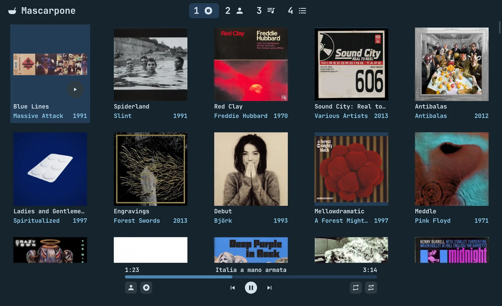
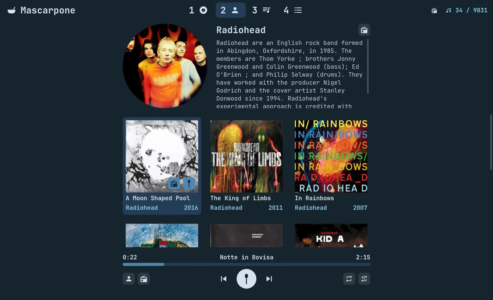
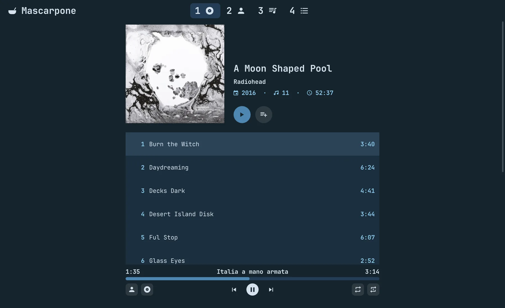
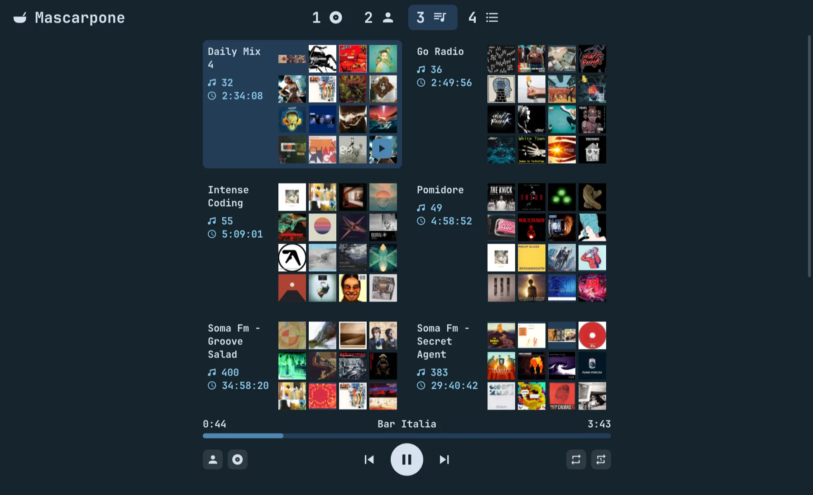
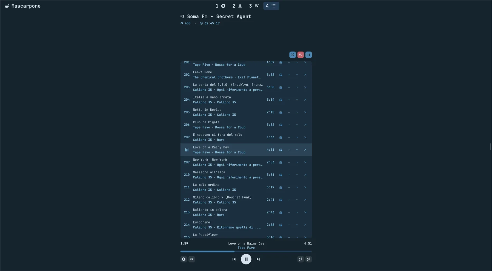
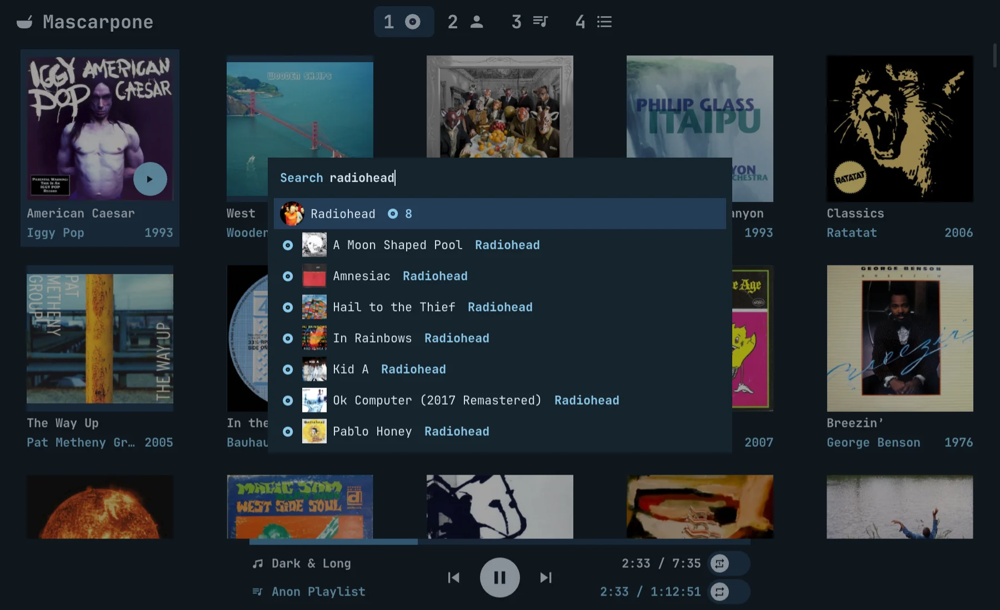

#  Mascarpone

An mpd client for the desktop (raylib, Rust): the music library, the
playlists (m3u files in a folder), the pictures, biographies and album
details fetched the way Lollypop does, and the usual player commands.
mpd keeps the music and plays it; Mascarpone is the window on it.

It lives in the scratchpad of sway next to the other players (the
`for_window` rule on its app id, `cards.random.Mascarpone`); the bar sees
what plays through mpd-mpris, not through Mascarpone.

A track without an album tag is filed under its folder, which stands in
for an album, with the folder's name.

| | |
|---|---|
|  |  |
|  |  |
|  | |

## Build

    make            # cargo build --release
    make install    # ~/.local/bin/mascarpone

raylib (6.2, without audio and models) is in `vendor/raylib` and is
built with the program, once, in `target/raylib` (`build.rs`, raylib's
own Makefile): it wants `make`, a C compiler and `wayland-scanner`.
GLFW, inside raylib, opens Wayland or X11 and EGL at run time; the font
is found by `fc-match`.
The window draws only when something changes (a key, the pointer, mpd,
a picture, the clock), and sleeps in between. On Wayland it draws a
frame only once the compositor has shown the last one: out of sight (the
scratchpad hidden) it draws nothing, the clock included.

## Configuration

`~/.config/mascarpone/mascarpone.conf`, the way `.conf` files are:
`key = value` lines under `[section]` heads, `#` starting a comment; a
key left out keeps its default, one not known is said on stderr.

    [mpd]
    host = localhost        # or a socket's path: /run/mpd/socket
    port = 6600
    password = secret

    [library]
    music = ~/Music         # mpd's music_directory
    playlists = ~/Music/Playlists

    [keys]
    play_pause = Space c    # an action = its keys, by spaces
    save_queue =            # nothing: no key

`MPD_HOST` (`password@host` too) and `MPD_PORT`, as mpc reads them, win
over the file. A key is a character as the keyboard's layout writes it
(`K` is Shift and k), or `Ctrl+`, `Alt+` and `Shift+` before a
character or a named key: Space, Enter, Escape, Tab, Backspace, Delete,
Up, Down, Left, Right, PageUp, PageDown, Home, End, KP_Add,
KP_Subtract, KP_0. Every action and its default keys:

| action | keys | |
|---|---|---|
| `commands` | Ctrl+k | the commands' picker: every action below, with its keys |
| `search_all` | / | the picker on everything |
| `search` | Ctrl+f | the picker on what is on screen |
| `albums` `artists` `playlists` `queue` | 1 2 3 4 | the tabs |
| `toggle_queue` | Tab | the queue shown, and hidden again: back where it was |
| `next_tab` `previous_tab` | Ctrl+Tab, Ctrl+Shift+Tab | |
| `back` | Escape | back a page |
| `play_pause` | Space c | |
| `stop` `previous` `next` | x z v | |
| `seek_forward` `seek_backward` | ] [ | ten seconds |
| `volume_up` `volume_down` | + =, - | five points |
| `repeat` `repeat_one` | r R | on or off |
| `go_to_playing` | g | the album or the playlist the queue plays |
| `save_queue` `clear_queue` | | |
| `refresh` | Ctrl+r | |
| `zoom_in` `zoom_out` `zoom_reset` | Ctrl+= Ctrl++, Ctrl+-, Ctrl+0 | the keypad's too |
| `quit` | Ctrl+q | |
| `left` `right` `down` `up` | j ;, k l, and the arrows | the grids and the lists |
| `open` | Enter | a card's page; on a list, play from the row |
| `add_to_playlist` | a | the selected track |
| `remove` `move_down` `move_up` | d Delete, K, L | the queue's rows |
| `picker_next` `picker_previous` | Down Tab Ctrl+n Ctrl+k, Up Shift+Tab Ctrl+p Ctrl+l | in the picker and the dialogs |
| `picker_page_down` `picker_page_up` | PageDown, PageUp | |
| `picker_open` `picker_close` | Enter, Escape Ctrl+g | |

## Use

Albums, Artists, Playlists and Queue in the header, which stays over
every page; a click on a tab, even the one on, comes back to its list,
dealt again (the keys below are the defaults: 1 to 4 or Ctrl+Tab
switch, Escape goes back a page). An album's, a playlist's, an
artist's page and the queue have the same head on top, still (the
cover or the portrait, the words beside it, an artist's scrolling on
their own), and under it the tracks or the albums in a block that
scrolls, down to the player; opened, the queue shows the song on in its
middle. The album and artist grids come in a random order, dealt again
by a click on their tab, by its key, and by Ctrl+R, which also
refreshes: mpd updates its database and the library is read again. When mpd's
database changes by itself (files synced in), the library is read again
once it has been still for 30 minutes.

One card is selected: j and ; move it left and right, k and l down and
up, Enter opens it, as does a click; the play button on an album's
cover or a playlist's covers (under the pointer, or on the selected
card) plays the album or the playlist. The
artist on an album card opens their page. On an album's or playlist's
page one track is selected (k and l, or Down and Up, move it; a click
plays from a row, or pauses the song on): Play and Enter play the list
from it, or pause and resume when it is the song on; Add to queue
appends. Space (or c) pauses and resumes anywhere, z, x and v go back,
stop and go on; Tab shows the queue and, again, hides it: back on the
tab and the page it was asked from. Ctrl+K lists every command with its
keys: type to find one, Enter does it.

The player bar at the bottom has the song's title over the time (a
click or a drag seeks), where the song is and its length at its ends;
under it a row of buttons: the artist (it opens their page) and the
album or playlist the queue plays (it opens its page) on the left,
previous, play and next in the middle, repeat and repeat one (mpd's
single and repeat together) on the right, lit while on.

`/` opens the picker on everything: albums, artists, playlists and,
once something is typed, every track; Enter opens its page, a track's
album with the track selected, so a second Enter plays it. Ctrl+F opens
the picker on what the window shows: the tab's albums, artists or
playlists; on the Queue tab albums and, once something is typed, every
track, to append to the queue (and to the playlist file the queue
points to); on an artist's page their albums and tracks; on an album's
or playlist's page its tracks, Enter selecting the row. Type to filter
(the name first, then the detail), Up/Down or Ctrl+n/p move, Enter
opens, Escape closes.

The playlists are the m3u files in `Playlists` under the music folder
(`~/Music`, both set in the configuration), their entries relative to the file; an entry the library
does not have is shown greyed and skipped. Shuffle, a square button
after a playlist's (and the queue's, when it plays one) other buttons,
lit while on (on unless switched off), plays it in a random order
(mpd's random mode, the queue in the file's order), from any track; an
album always plays in order. It is kept in
`~/.local/state/mascarpone/shuffle.json` by the playlist's name, not in
the file: the playlists sync, and another machine rewrites them. Delete,
at the bottom of a playlist's page, asks first, then moves the file to
`~/.local/state/mascarpone/deleted` (out of the music folder, which
syncs), its name stamped with the time: it can be taken back from
there.

Every size is in rem (`src/size.rs`), in quarter steps, a rem the
desktop's font size (GNOME's `font-name`) in the screen's pixels:
Ctrl+= or Ctrl++ zooms in, Ctrl+- out, Ctrl+0 back to 100%; the zoom is
kept in `~/.local/state/mascarpone/zoom`. The look is lintel's
(`src/ui.rs`): palette and font (JetBrainsMono Nerd Font Propo, every
icon one of its glyphs), flat (no frames, shadows or rounded corners
but on buttons), no animations, no window buttons, since the window
lives in the scratchpad. A character the font does not have shows as a
box: there is no other font to fall back on.

## Artists from the net

An artist's portrait and biography come from the net the first time
they are shown and are kept in `~/.cache/mascarpone/artists`: MusicBrainz
names the artist and links it to Wikidata and Wikipedia, whose summary
gives the words and the lead picture; TheAudioDB (free key `123`) gives
a portrait by MusicBrainz id and words when Wikipedia has none; Deezer
a picture when nobody else has one. MusicBrainz is asked once a second
at most, with `mascarpone/0.1 (https://random.cards)` as User-Agent.
After the words on an artist's page, Wikipedia's glyph opens the
article, and the last one forgets what the cache has and asks the net
again.

An album mpd has no cover for gets one from the net, Deezer's or the
Cover Art Archive's, written as `cover.jpg` in the album's folder like
the others when the folder is the album's alone; an album the net has
nothing for is marked in the cache (`<hash>.none`) and not asked again
until Ctrl+R, which drops the marks.

## The master list

The queue is mpd's; Mascarpone keeps a pointer to where it was loaded
from (`~/.local/state/mascarpone/master.json`). Play on an album or a playlist
loads it whole and points there; Add to queue appends and drops the
pointer: the queue is then the Anon Playlist, put together by hand, until
Save as playlist on the Queue tab writes it as an m3u8 file in
`Playlists` and points there. The player bar's album button shows what
the queue plays, an album or a playlist (a saved one or the Anon
Playlist), and opens it. Queue is the fourth tab (`4`); there every row
can be moved up and down (L and K on the selected one) and removed (d or
Delete), and Clear empties the queue. Other clients change the queue too: when it no
longer matches the list pointed to, the pointer drops. On a track (a
selected row of an album or playlist page) `a` adds it to a playlist,
picked or created by name; a playlist the master points to grows in
the queue as well.

## Layout

- `src/main.rs`: the window's loop, one instance only.
- `src/app.rs`: what the window knows (the library, the status, the
  queue's pointer, the pages open) and does: the actions a frame asks,
  the keys.
- `src/view.rs`: the header and its tabs, the grids, the playlists'
  cards, the word under the tabs.
- `src/pages.rs`: a page per album and playlist and the queue's tab
  (the tracks), a page per artist.
- `src/player.rs`: the player bar.
- `src/picker.rs`: the picker on Ctrl+F and `/`, and the other dialogs.
- `src/ui.rs`: the palette, the text styles, the input of a frame and
  the widgets drawn and asked at once.
- `src/text.rs`: the font, drawn from atlases made at each size used.
- `src/rl.rs`: raylib and the GLFW in it, the little used.
- `src/size.rs`: every size in rem, the zoom.
- `src/bars.rs`: the playing mark, bars that bounce next to the song on.
- `src/glyphs.rs`: every icon, a glyph of the Nerd Font.
- `src/mpd.rs`: the connection to mpd on a tokio thread of its own,
  commands in, events out (status, library, covers).
- `src/library.rs`: albums, tracks and artists built from mpd's
  `listallinfo`, and the playlists read from the m3u files.
- `src/master.rs`: the queue's pointer, and the playlist files written.
- `src/net.rs`: portraits, biographies and missing covers from the net.
- `src/covers.rs`: covers from mpd (embedded or the file next to the
  album) or the net, shrunk once into `~/.cache/mascarpone/covers`,
  decoded on threads of their own, the last few hundred shown kept as
  textures; the artists' portraits.
- `src/dirs.rs`: the XDG folders, the local time.
- `docs/`: the icon (the launcher's) and the screens in this file.
